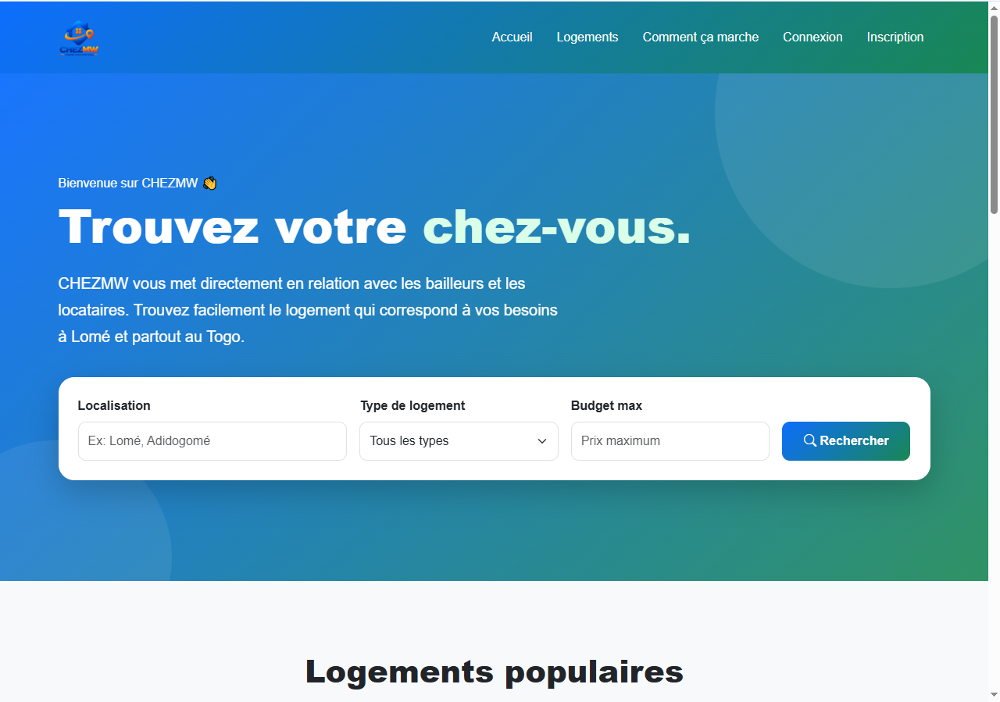
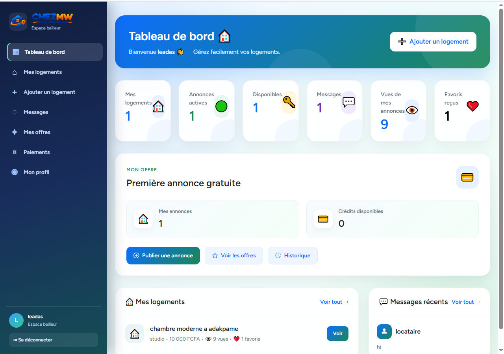
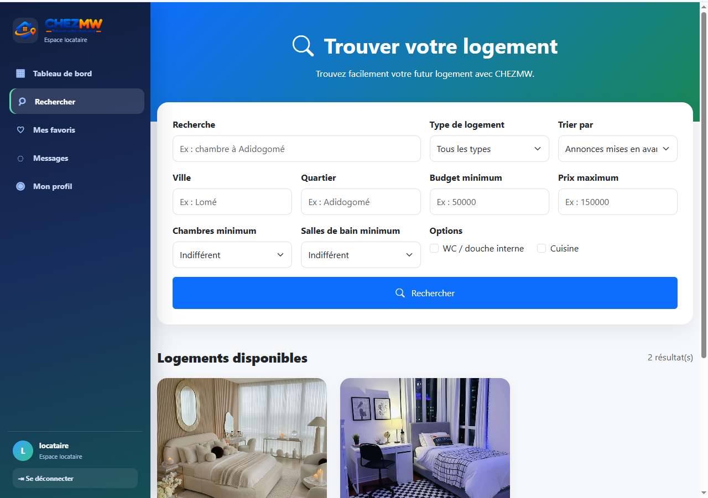
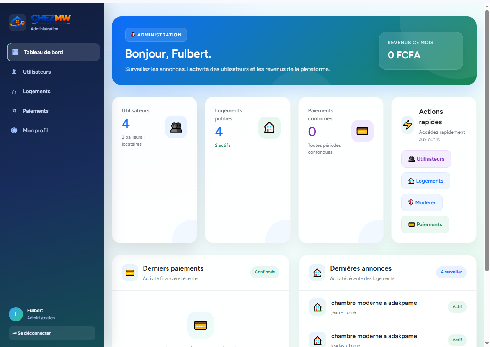
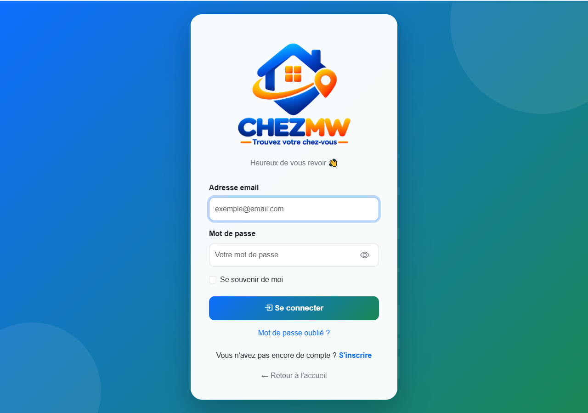
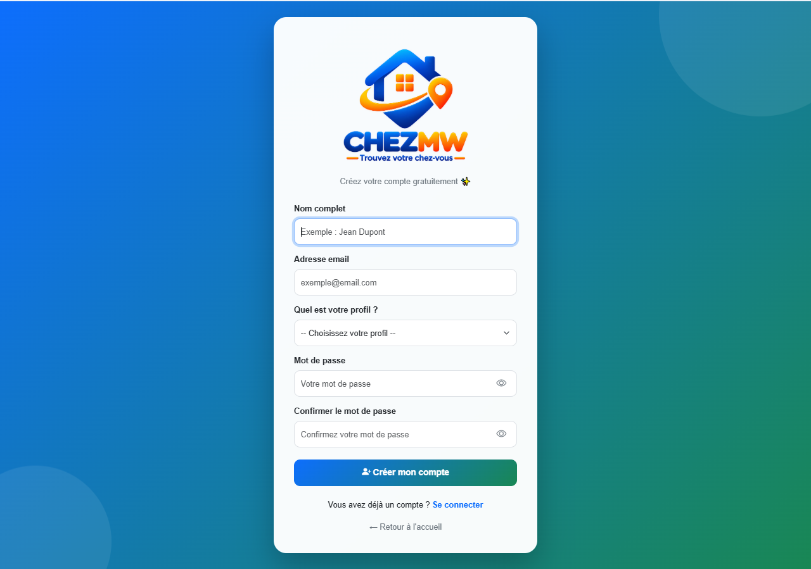

# ChezMoi — Real Estate Web Application

ChezMoi is a real estate web application developed with Laravel. The project is designed to provide a digital platform for presenting and managing property listings.

## Features

* Real estate listing and property management
* Structured Laravel application architecture
* Responsive web interface
* Database integration
* Automated testing structure

> Update this section to reflect only the features that are actually implemented in the application.

## Tech Stack

* **Backend:** PHP, Laravel
* **Frontend:** Blade, JavaScript, CSS
* **Database:** Configure according to your environment
* **Build tools:** Node.js, npm, Vite
* **Mobile:** Capacitor integration (Android and iOS project folders included)

## Requirements

* PHP version compatible with `composer.json`
* Composer
* Node.js and npm
* A supported database

## Installation

1. Clone the repository:

   ```bash
   git clone https://github.com/Fulbert-Dev/ChezMw.git
   cd ChezMoi
   ```

2. Install PHP dependencies:

   ```bash
   composer install
   ```

3. Create your environment file:

   ```bash
   copy .env.example .env
   ```

4. Generate the Laravel application key:

   ```bash
   php artisan key:generate
   ```

5. Configure your database in `.env`, then run:

   ```bash
   php artisan migrate
   ```

6. Install frontend dependencies and build assets:

   ```bash
   npm install
   npm run build
   ```

7. Start the local development server:

   ```bash
   php artisan serve
   ```

Open the local URL displayed in your terminal.

## Security

* Never commit `.env` or other files containing credentials.
* Use environment variables for private configuration.
* Review configuration files before publishing the repository.

## Project Screenshots

### Homepage



### Property Listings



### Property Details



### Property Search and Filters


### Owner Dashboard


### Administrator Dashboard



### login



### register




## Author

**Fulbert-Dev**

GitHub: https://github.com/Fulbert-Dev
